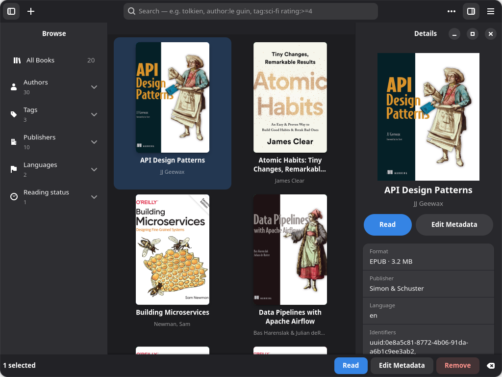
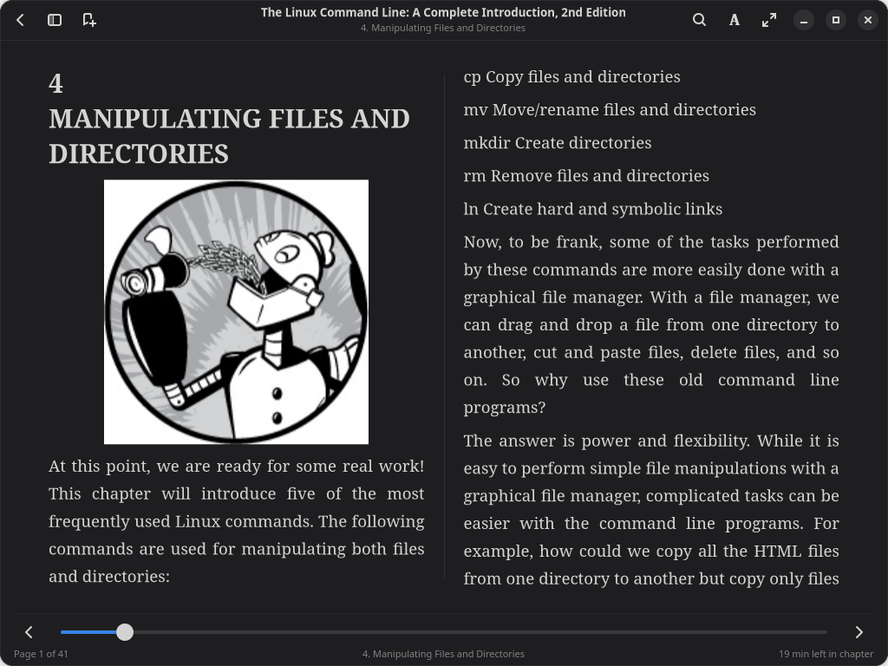
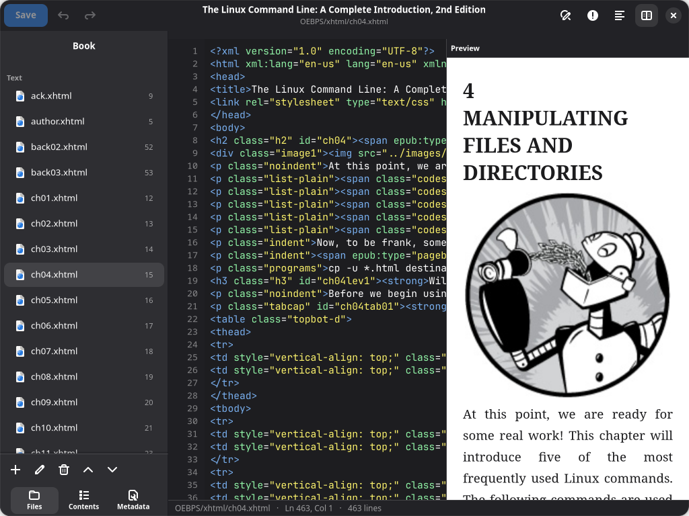
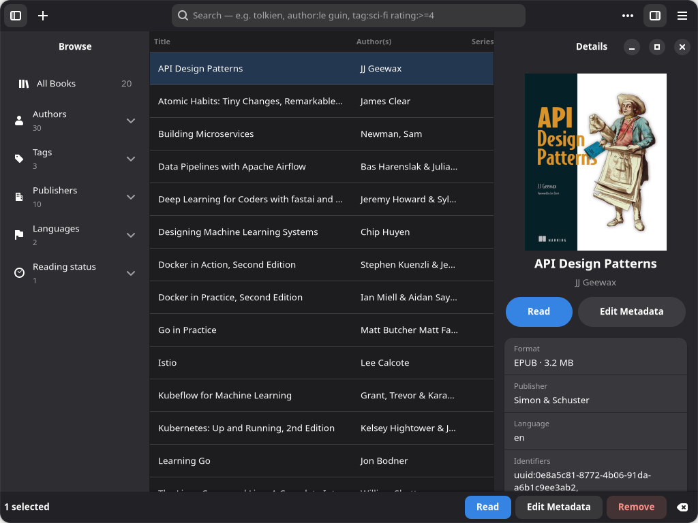
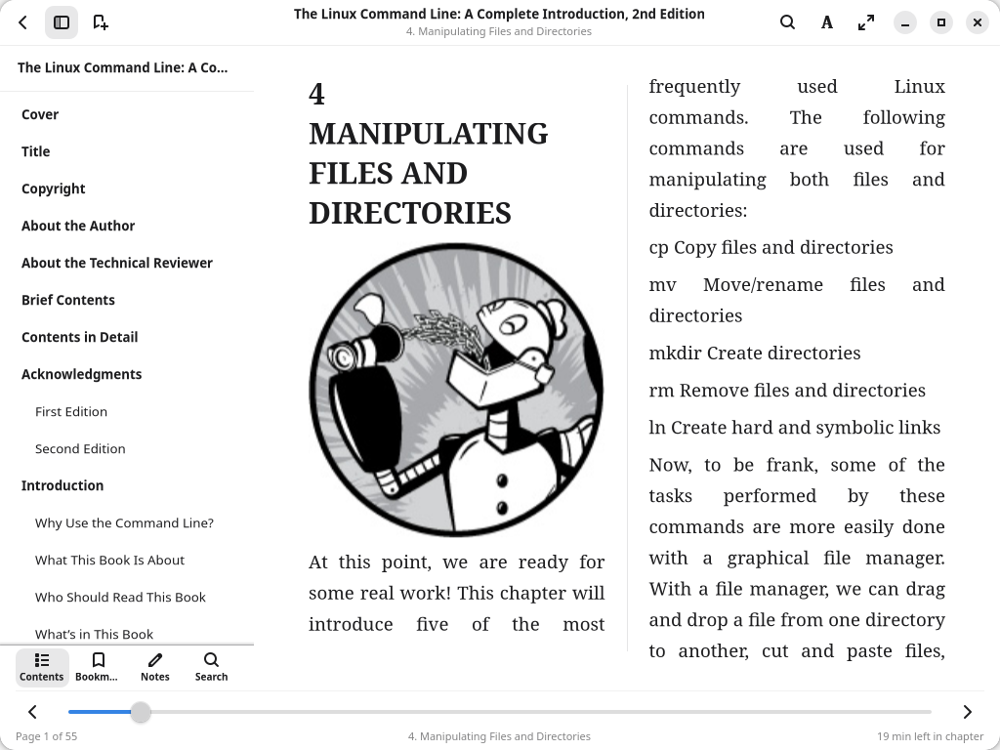

# Bookx

[](https://stopthemingmy.app)

**A modern e-book library, reader and editor for GNOME — written entirely in Rust.**

Bookx is a native GTK 4 + libadwaita application built with [Relm4](https://relm4.org).
It has three parts that share one window system and one engine:

| | |
|---|---|
| **Library** | A Calibre-style library manager: cover grid or sortable table, tag browser, Calibre search syntax, full metadata editing, bulk edits, import/export. |
| **Reader** | A paged EPUB reader with its own Rust text-layout engine (Pango + cairo). No web view, no JavaScript. |
| **Editor** | A built-in EPUB editor — a Rust take on Calibre's *Edit book*: files, code editor, live preview, find & replace, TOC editor, book checker. |

<div align="center">



</div>

<table>
<tr>
<td></td>
<td></td>
</tr>
<tr>
<td></td>
<td></td>
</tr>
</table>

## Features

### Library
- A clean start: a yellow *Continue Reading* card and your covers, each with its progress (`5% ▬▬`) and title underneath. Search, the browse panel, the details panel (it opens when you click a book, with its toggle in the header bar) and the table view are one click away in the header / menu, never in your face. *News Subscriptions…* is in the **+** menu, the main menu and on the welcome page.
- **Browse** panel — Authors, Series, Tags, Publishers, Languages, Ratings, Reading status — with counts; click to filter.
- **Calibre-style search**: `author:"le guin" tag:fantasy -rating:<3`, `series:=Dune`, `status:unread`, `size:>10`, `a OR b` …, and **`text:"words in the book"`** to search the *contents* of every book (indexed in the background, inside the library's own database).
- **Plugins**: sandboxed WebAssembly extensions (Preferences → *Extensions*, folder `~/.local/share/bookx/plugins/`, all off until you switch them on) add metadata sources, file readers, output formats (*Convert To*), transforms (library tools, the editor's Tools menu, optionally every conversion) and device drivers (*Send to*); each plugin only gets what its manifest asks for, and Preferences shows the permissions. **Patches** are small TOML files with regex/CSS rules (`~/.local/share/bookx/patches/`) applied after import, before/after conversion or when opening a book; they can be ordered and dry-run in Preferences. How to write both, with a worked example: [docs/plugin-development.md](docs/plugin-development.md).
- **Library Health** (menu → *Library Health…*): backups of the catalogue (automatic snapshots on start-up and exit, *Back up now*, *Restore from a backup* that first saves the current catalogue), a **library check** (database integrity, missing files and covers, book files nobody lists, and optionally books whose metadata differs from their file, each with a fix), **Import Calibre Library…** (progress, a report of what was imported, skipped or already there; copy the files in or keep them in the Calibre folder), a **watched import folder** with a review queue (nothing is added on its own), **History** with *Undo* for imports, deletions, edits and layout changes, a **Trash** (deleting a book moves its files there; restore or empty), and **name tidying** (one spelling per author and series, series with numbers missing). A library held by another running Bookx opens **read-only** with a message saying who has it; a library on a network share or in a Dropbox/Syncthing-style folder gets a one-time warning. *Preferences → Library* chooses where books are kept: author/title folders (default), one flat folder, a path template such as `{author}/{series}/{title}`, or *link in place* (books stay where they are and are never moved or deleted); changing it shows what will move and either moves everything or nothing.
- **Fetch metadata** from Open Library, Google Books and Wikidata in the edit dialog (fills the empty fields, or replaces everything; also the cover).
- **Edit metadata** like Calibre: title, authors, series + number, rating, tags, publisher, date, language, identifiers, title/author sort, comments, cover. Written *into* the EPUB, and the book is re-filed as `Author/Title (id)/…`.
- **Bulk edit** several books at once (add/remove tags, set author, series, publisher, language, rating).
- **Import** EPUB, FB2/FBZ, MOBI/AZW/AZW3, DOCX, ODT, RTF, comics (CBZ/CBT/CBC), CHM, PDB, PML, RB, SNB, TCR, LRF (best effort), TXT, Markdown (with front matter), HTML and more — everything is converted to EPUB. Drag & drop files or whole folders; duplicates are skipped.
- **AI assistants (MCP)**: Claude, Cursor, opencode and other assistants can search, read and (if you allow it) annotate your library through the Model Context Protocol: `bookx-cli mcp` over stdio, or a token-protected local server inside the app (Preferences → *AI Assistants (MCP)*). Read-only by default; see the wiki page *AI assistants*.
- **Preferences** is a sidebar of sections (General, Library, Reading, Devices and Sharing, E-mail, Sync, Extensions, Patches …) with one search over all of them; it collapses to an overlay in narrow windows. The book editor has its own command palette (Ctrl+Shift+P: editor commands, Tools/Markup/Files menu items, files), right-to-left books mirror the reader's footer and sidebar, and the reader's bars stay visible while a menu or the read-aloud controls are in use.
- **Send by e-mail** (book menu → *Send by E-mail*): mails the book as an attachment to the address set in Preferences → *E-mail* (a Kindle's Send-to-Kindle address, for example); STARTTLS or TLS with a user name and password, and the 50 MB Kindle limit is checked. The password is kept in the settings file, so use an app password.
- **Find duplicates** (menu → *Find Duplicates…*): copies of the same book are grouped; pick which one to keep and merge: metadata, highlights, bookmarks and reading progress are united.
- **Add from the web** (*+* → *Add from the Web…*): a page address becomes a readable book (read it later, with images), a feed address (RSS, Atom, JSON Feed) becomes a news book of its latest articles.
- **News subscriptions** (*+* → *News Subscriptions…*): subscribe to one or more feeds (add lines starting with `#` to switch a feed off, or import an OPML file) and Bookx builds a new tagged *News* book on a schedule (manual, hourly, daily, weekly, in your local time) while it is open. *Download Now* and *Download All Due* are in the window. Only the newest *Issues to keep* issues stay in the library. A failed download is shown in the list and waits for the next slot instead of retrying every minute. Subscriptions live in `news.json` next to the settings.
- **Convert** books to KEPUB (Kobo), AZW3/MOBI (Kindle), FB2, HTMLZ, TXTZ, DOCX, RTF, PDB (eReader), PMLZ, RB, SNB, OEB, ZIP, cleaned-up EPUB, TXT, Markdown or HTML (right-click → *Convert To*); **share the library** over OPDS and a web page (menu → *Share Library…*; a password is required before other devices can connect), with optional KOReader progress sync; **export annotations** (highlights, notes, bookmarks) to JSON, Markdown or text; save a copy; show in Files. **Device button** in the header bar while an e-reader is connected, opening the **Device window**: the books on the device with their covers (grid or list), a phone mounted over MTP or a WebDAV cloud folder, free space, main memory versus SD card, a *Books to send* list (right-click → *Send to Device…*) that shows per book the format, whether it is converted, the notes added and any warning, with check boxes and a *Send N books* button; the copy sent gets your notes as a last “My notes” section and a KOReader notes file (switchable; your library copy is unchanged), remove books, the format to send (with fallbacks), a save-path template, an optional Kobo shelf (the Kobo database is backed up first). When a device connects a banner offers to sync reading progress, highlights and notes (*Sync / Always / Not now*), after a summary of what goes in which direction; syncing is always progressive and never deletes or lowers anything, and can be made automatic in Preferences (cable-connected readers only: Kobo's own state or KOReader's files). KOReader *Progress sync* over Wi-Fi is a separate switch in *Share Library…* (reading position only; the window shows the address to type into KOReader). *Share Library…* can serve **HTTPS** with your own certificate and key or a self-signed one Bookx makes. Device features are tested with simulated devices only; real hardware has not been tried. Books sent with notes get an *Annotations* chapter and, for EPUB/KEPUB readers, a KOReader sidecar (KOReader keeps jump targets at chapter level).
- Multi-selection, context menus, details panel, remove with confirmation, portable library folder (a SQLite catalogue, `bookx-library.db`, next to plain book files). A library from an older version (`bookx-library.json`) is moved into the database the first time it is opened; the old file is kept as `bookx-library.json.migrated`.

### Reader
- **Two columns**, single column, or continuous scroll; real line-based pagination.
- Themes: follow system, light, **sepia**, dark, black. Font family, size, line spacing, margins, justification.
- **Highlights in 5 colours and 4 styles** (background, underline, strikethrough, squiggly), notes, bookmarks, text selection with copy, offline **dictionary lookup** (StarDict dictionaries in `~/.local/share/bookx/dictionaries/`), Wikipedia lookup and translate.
- **Colours** (reader menu → *Theme / Original / Custom*): *Original* shows the text and page colours the book itself asks for, *Custom* lets you pick your own text and page colours; the editor preview has the same control (palette button above the preview).
- **The book's own styling** (CSS classes for italic, bold, underline, small caps, monospace, alignment, hidden text, first-line indents and paragraph spacing) is applied on top of the plain structure (Preferences → *Use the book's own styling*).
- **Touch and tablets**: swipe to turn pages, long-press to select a word, configurable tap zones (edges, thirds, left-handed, wide, off) and large touch controls (Preferences). **E-ink mode**: pure black on white, no animations, bars that stay, wide tap zones.
- **Hyphenation** in the language of the book (Preferences → *Hyphenate words*), justified text without rivers.
- **Optimal line breaking** (Knuth-Plass, as in TeX) in justified text, with Pango's own breaking as the fallback (right-to-left text, or switched off in *Text appearance*).
- **Drop caps and floats** from the book's CSS: `::first-letter { float: left }` and floated images; the text wraps around them.
- **Text appearance** (header button; every change is kept for the book, with defaults for new books): line height, margins, paragraph spacing, font, force justification, optimal breaking, hyphenation language and your own style sheet that is applied after the book's, for all books or for the open one.
- **Read aloud** (speaker button in the header): reads sentence by sentence with the sentence highlighted, gapless, with speed, pitch, voice, skip and a sleep timer; goes on with the next chapter. A floating player card (seek bar, previous/next sentence and chapter, speed, voice, sleep timer, volume, media keys) appears while it reads. Natural voices (Kokoro, Piper) run on your computer; the first time you press Read Aloud Bookx offers to download the default voice in the background and starts reading when it is ready; any OpenAI-compatible, XTTS or Fish Speech server works too. See the wiki page *Read aloud*.
- **Fixed-layout EPUB** (`rendition:layout` pre-paginated): one page at a time, pictures scaled to fit the screen. No spreads, no absolutely positioned text.
- **Reading statistics** (menu → *Reading Statistics*: time today/week/month, streaks, reading speed, a 7-day chart, most-read books) and a **vocabulary** of looked-up words reviewed as spaced-repetition flashcards (menu → *Vocabulary*).
- Table of contents, bookmarks, notes and **full-book search** in the sidebar; links, footnotes with *Back*; images.
- Progress slider for the whole book, "63 of 807" page counter, chapter + minutes-to-complete status, keyboard & wheel navigation.
- Header and navigation fade away after a few idle seconds so the page fills the window; pointer movement brings them back.
- Opens maximised and restores the library size on return; spinner while the book loads.
- Main menu: theme, zoom %, Open Book, Reload (Ctrl+R), Properties, Layout, Preferences, Shortcuts. Double-click the margin for fullscreen; pinch or Ctrl+wheel to zoom.
- Selecting text: highlight colours (kept active, with note/remove), comments saved when you click away, inline Wikipedia summary and translation (language picker).
- Reading position is remembered per book.

### Editor
- **Tools** menu: fix problems automatically, upgrade to EPUB 3, add or remove a contents page, improve accessibility, compress images, shrink embedded fonts, arrange files into folders, a *Book Report*, *Check Spelling* (uses the Hunspell dictionaries installed on the system), and **checkpoints**: every tool snapshots the book first, so anything can be undone with *Restore Checkpoint*.
- **Files** grouped by type with reading-order numbers; select several with Ctrl/Shift-click. Rename (F2; every `href`, `src`, CSS `url()` and `#fragment` is repaired, other files with similar names are left alone), delete (Delete key), reorder the spine, and from the ⋯ menu or a right-click: *New File…* (templates, optional stylesheet links, Ctrl+N), *Merge Selected…*, *Bulk Rename…*, *Link Stylesheets…*, *Export Selected…*. Every change of the whole book first takes a checkpoint named “Before: …”.
- **Tabs** for the files you opened (Ctrl+W closes, Ctrl+Alt+Down/Up step through the reading order) and **quick open** (Ctrl+P).
- **Markup menu** (the `<>` button): select to / jump to the matching tag (Ctrl+Alt+K / Ctrl+Alt+J), close the open tag, wrap the selection in a tag, remove the surrounding tag, rename a tag, change a block to a paragraph or heading 1-6 (Ctrl+0…6), toggle a comment (Ctrl+/), change case.
- Code editor for XHTML / CSS / OPF / NCX with **syntax highlighting, line numbers and undo/redo**; one-click XML reformat.
- **Live preview** rendered by the same engine as the reader.
- **Find & replace** with the full regex dialect (look-around, `\1`), case option, scopes (this file, all text, styles, marked text), live match counts, *Find All* result list, *Go to line* (Ctrl+L) and *Mark selected text* (Ctrl+Shift+M).
- **Table-of-contents editor** (rename, indent, reorder, link) writing both `toc.ncx` and `nav.xhtml`. Selecting an entry opens its file at the anchor. *Generate…* builds it from headings (levels 1-6), from the links of a contents page, or one entry per file, replacing or adding to the current one.
- **Code view** on GtkSourceView: syntax highlighting that follows light/dark/e-ink, line numbers, minimap, tag-pair highlight, all find matches highlighted, a marks column (lines changed since the last checkpoint, findings of the book check, misspelled-word counts), spelling underlines with *Replace with… / Ignore / Add to Dictionary*, completion (tags, attributes, CSS properties, file names, anchors, classes, words), snippets with tab stops (*Manage Snippets…*) and *Show Hidden Characters*.
- **Split and merge** (Tools): split the open chapter at its chapter headings, or merge it with the next file; links, TOC and manifest are repaired and the step can be undone with a checkpoint.
- **Check book** (F7): XML errors, missing/unmanifested files, duplicate ids, spine problems, broken links and anchors, missing metadata. It also runs an EPUB validator (87 rules with epubveri-style ids such as `[OPF-003]`), and *Compare with Checkpoint* shows what changed since a snapshot.
- Metadata and cover editing, "use image as cover", save back into the library.

See the design documents in [`mockups/`](mockups/):
[library](mockups/bookx-library.png) · [reader](mockups/bookx-reader.png) · [editor](mockups/bookx-editor.png).

## Build & run

Bookx needs **GTK ≥ 4.20**, **libadwaita ≥ 1.8** (GNOME 49 or newer) and **GtkSourceView ≥ 5.6** (the book editor's code view) plus a recent stable Rust.

```bash
# Fedora
sudo dnf install gcc pkgconf-pkg-config gtk4-devel libadwaita-devel gtksourceview5-devel pango-devel cairo-devel gdk-pixbuf2-devel
# Debian / Ubuntu
sudo apt install build-essential pkg-config libgtk-4-dev libadwaita-1-dev libgtksourceview-5-dev
# Arch
sudo pacman -S base-devel gtk4 libadwaita gtksourceview5

cargo run --release
```

Install it (binaries, desktop file, icons, metainfo, file types and the `bookx://` link handler):

```bash
make install PREFIX=~/.local
```

Optional at run time: `espeak-ng` and `pacat`/`pw-cat` for read aloud, Hunspell dictionaries for spell checking; `gettext` (`msgfmt`) to install compiled translations.

Flatpak (GNOME 50 runtime, built offline from `build-aux/cargo-sources.json`; `make flatpak` runs it with smoke tests):

```bash
flatpak install flathub org.gnome.Platform//50 org.gnome.Sdk//50 org.freedesktop.Sdk.Extension.rust-stable//25.08
BUNDLE=1 build-aux/flatpak.sh
flatpak install --user bookx.flatpak
```

Translations: [Translating Bookx](https://bookx.adhadse.com/translating/). Bug reports: *About → Troubleshooting* (or the palette's *Copy Diagnostics*) has the text to paste.

Your library lives in `~/Documents/Bookx Library` by default (change it in *Preferences*).
Settings are stored in `~/.config/Bookx/config.json`.

## Command line

`bookx-cli` (crate `crates/bookx-cli`) does the library and conversion work without the GUI:

```bash
cargo run -p bookx-cli -- formats                     # supported input / output formats
cargo run -p bookx-cli -- convert book.fb2 book.kepub.epub --smarten --device kobo
cargo run -p bookx-cli -- convert book.epub book.mobi --preset "Kindle (MOBI)"
cargo run -p bookx-cli -- meta show book.epub --json
cargo run -p bookx-cli -- meta set book.epub --title "New" --author "A. Writer" --cover cover.png
cargo run -p bookx-cli -- check book.epub             # exit code 1 when errors are found
cargo run -p bookx-cli -- library add ~/Downloads -r  # other formats are converted to EPUB
cargo run -p bookx-cli -- search 'author:le guin rating:>=4' --json
cargo run -p bookx-cli -- serve --port 8080 --user me:secret   # OPDS + web page + KOSync
cargo run -p bookx-cli -- mcp                          # MCP server over stdio for AI assistants (read-only); --http ADDR:PORT --token T, --allow-write
cargo run -p bookx-cli -- library backup               # snapshot of the catalogue; also: snapshots, restore latest
cargo run -p bookx-cli -- library check --drift        # database, files, covers, file vs catalogue; --fix applies fixes
cargo run -p bookx-cli -- library import-calibre ~/Calibre\ Library --copy
cargo run -p bookx-cli -- library layout flat --dry-run  # tree | flat | template --template '{author}/{title}' | linked
cargo run -p bookx-cli -- library trash list           # also: trash restore ID, trash empty, history, undo
cargo run -p bookx-cli -- library tidy --apply         # one spelling per author and series
cargo run -p bookx-cli -- library inbox set ~/Downloads/books   # then: inbox scan | add-all | dismiss-all
```

The library is `--library DIR`, else `$BOOKX_LIBRARY`, else `~/Documents/Bookx Library` (the same
as the app). Commands that change the library take its lock (`.bookx-lock`) and stop with a clear message when another Bookx has it open. Exit codes: `0` success, `1` the command found problems, `2` usage or runtime error.

## Documentation

The user guide is at **<https://bookx.adhadse.com>**: install, library, reading, editing, converting, devices and
sharing, plugins, the command line and keyboard shortcuts. Its source is in [`wiki/`](wiki/) (Zensical); build and
check it locally with:

```bash
build-aux/wiki.sh          # builds wiki/site and fails on broken links
build-aux/wiki.sh serve    # live preview
build-aux/wiki-screenshots.sh   # real screenshots for the wiki (sandboxed GNOME Shell session)
```

Internal notes (roadmap, bugs, research) stay in [`docs/`](docs/).

## Hacking

```bash
cargo test                    # engine tests (OPF/TOC editing, search, conversion, …)
cargo clippy --all-targets -- -D warnings
cargo run --example mockups   # regenerate mockups/*.svg and mockups/*.png (pure Rust, via resvg)
```

Run the engine tests against your own books (read-only copies are made in memory):

```bash
BOOKX_TEST_EPUBS=~/CalibreLibrary cargo test real_world -- --nocapture
```

Source layout:

```
src/core/      GUI-independent engine
  archive.rs     in-memory EPUB zip      opf.rs      package parsing + text-splice editing
  toc.rs         nav/NCX read & write    html.rs     XHTML → Doc (intermediate model)
  library.rs     catalogue & file tree   query.rs    Calibre search language
  convert.rs     TXT/MD/HTML ⇄ EPUB      check.rs    book checker
src/ui/        Relm4 components
  library.rs reader.rs editor/ (mod, files, search, tools, toc_tab, tags, nav, …) metadata.rs preferences.rs
  canvas.rs      the text layout / paging / selection engine (Pango + cairo)
  syntax.rs      XML/CSS highlighting
examples/mockups/  the mockups, drawn in Rust
```

More background in [`_developer/docs.md`](_developer/docs.md).

## What Bookx is not (yet)

- EPUB is the native format; many others are converted on import. PDF opens page by page (pure Rust, `bookx-pdf`) with an experimental text reflow; no OCR for scans.
- No metadata download, device transfer (*send to Kindle*) or DRM handling.
- The reader draws its own text, so it does not apply book CSS and the page itself is not exposed to screen readers yet.

## Pronunciation

The app is pronounced just like "Books" but the "s" replaced with "x", as in an extension of something that manages your books. And not "Book-ex" :)

## Contributing

Issues and pull requests are welcome. Read the [GNOME HIG](https://developer.gnome.org/hig/) if you are new to
GNOME app design, and check the mockups before changing UI. The previous Meson/Flatpak/gresource setup of the
2023 prototype is kept in [`_legacy/`](_legacy/) for reference.

Licensed under the GPL-3.0-or-later.
