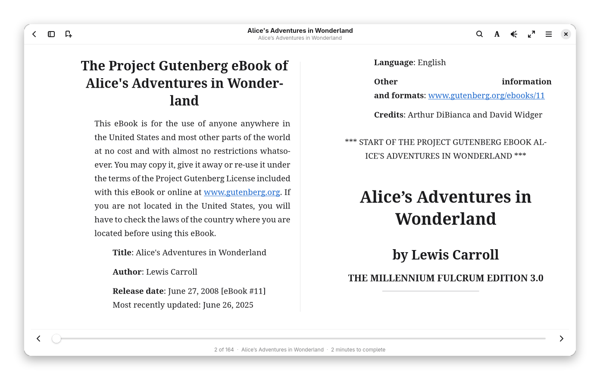
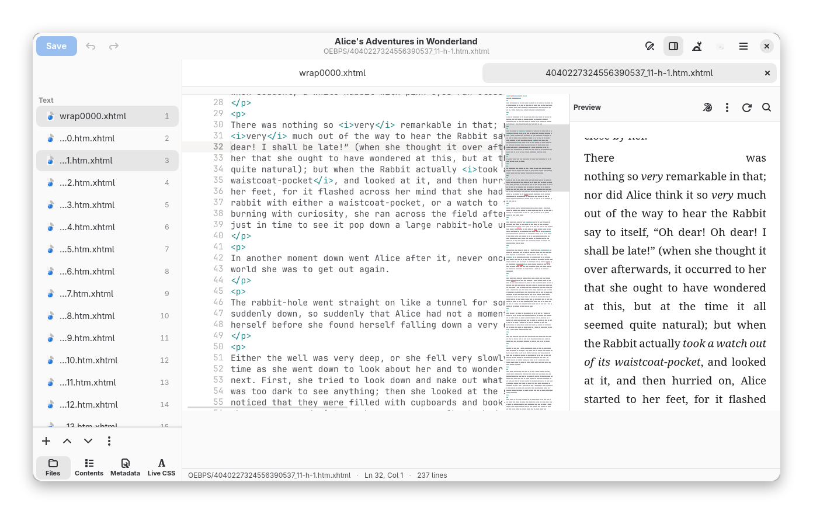
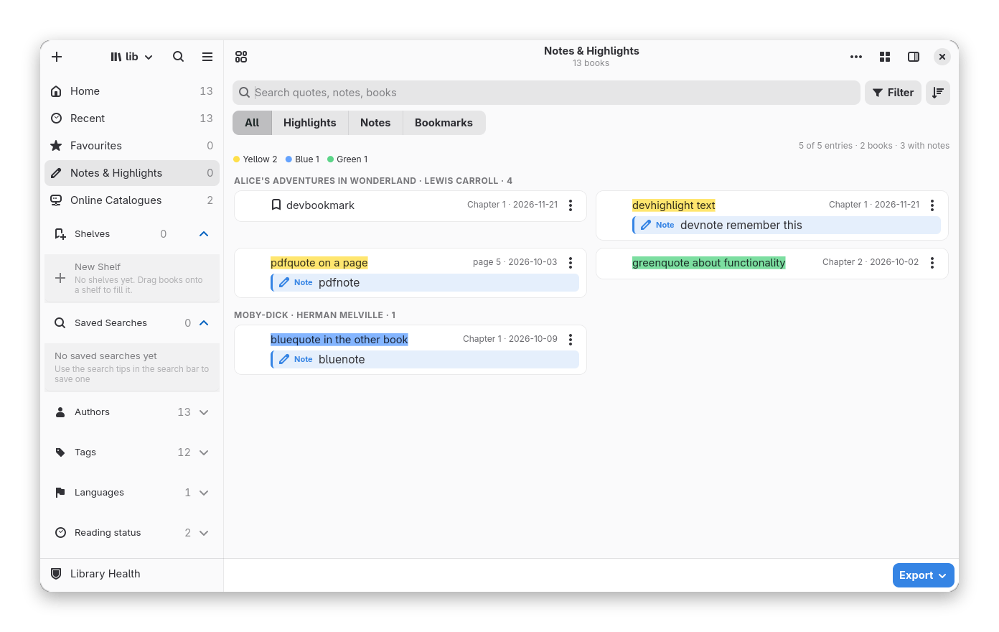

# Bookx

[](https://stopthemingmy.app)
[](https://github.com/adhadse/Bookx/releases)

**A GNOME-native e-book library, reader and EPUB editor, written in Rust with GTK 4, libadwaita and [Relm4](https://relm4.org).**

> **Beta.** Bookx 0.4.0-beta.1 is beta software. It can have bugs, so keep a backup of anything you care about (Bookx can back up your library for you). Reports help us fix bugs: choose **Main Menu → Report a Problem**, read the log report, then **Open GitHub Issue**. Download it from [GitHub Releases](https://github.com/adhadse/Bookx/releases/latest); there are Linux (x86_64) files only for now.

📖 **Documentation: <https://bookx.adhadse.com>** (features, formats, limits, shortcuts, command line, devices, plugins)


<picture><source media="(prefers-color-scheme: dark)" srcset="wiki/docs/assets/library-banner-hero-dark.png"></picture>
<picture><source media="(prefers-color-scheme: dark)" srcset="wiki/docs/assets/reader-dark.png"></picture>

<picture><source media="(prefers-color-scheme: dark)" srcset="wiki/docs/assets/editor-preview-dark.png"></picture>
<picture><source media="(prefers-color-scheme: dark)" srcset="wiki/docs/assets/library-notes-dark.png"></picture>


This README is for people working on Bookx. What the app can and cannot do is described in the
[wiki](https://bookx.adhadse.com); its source is in [`wiki/`](wiki/).

## Status and scope

- Version `0.4.0-beta.1` (see [CHANGELOG.md](CHANGELOG.md)). Linux and GNOME (GTK ≥ 4.20, libadwaita ≥ 1.8) come first.
  **GitHub Releases is the official channel** ([latest release](https://github.com/adhadse/Bookx/releases/latest): Flatpak bundle,
  `.deb`, `.rpm`, tarball; signed, see the [install page](https://bookx.adhadse.com/install/)). Flathub and other package
  managers (Homebrew, winget, Scoop) are planned for later, once the project has history ([docs/release-plan.md](docs/release-plan.md)).
  macOS and Windows have bundling scaffolding only ([docs/macos-port.md](docs/macos-port.md),
  [docs/windows-port.md](docs/windows-port.md)).
- Pronounced "Books" with the "s" replaced by "x" (an extension of something that manages your books), not "Book-ex".

Where the work is going (details in the linked files, not repeated here):

- Open work items and caveats: [docs/remaining.md](docs/remaining.md); index of all internal documents: [docs/README.md](docs/README.md).
- The feature roadmap and the owner's decisions: [docs/bookx-feature-roadmap.md](docs/bookx-feature-roadmap.md), progress in [docs/roadmap-status.md](docs/roadmap-status.md).
- UI polish and usability: [docs/archive/human_interface_backlog.md](docs/archive/human_interface_backlog.md), [docs/archive/ux-gaps-notes.md](docs/archive/ux-gaps-notes.md).
- Testing on real hardware (e-readers, phones, Kindle): [docs/hardware-test-plan.md](docs/hardware-test-plan.md).
- **How a release is made** (tag, workflows and their order, `.deb`/`.rpm`/Flatpak, verification): [docs/releasing.md](docs/releasing.md).
- Release plan and distribution (GitHub Releases first, Flathub later): [docs/release-plan.md](docs/release-plan.md); packaging details (deb/rpm, Flatpak, macOS, Windows): [docs/packaging-notes.md](docs/packaging-notes.md).
- Known bugs and enhancement ideas: [docs/bugs.md](docs/bugs.md), [docs/enhancements.md](docs/enhancements.md).

Non-goals (decided by the owner, see the roadmap Part 2): DRM removal; a cloud service run by the project;
Calibre's wireless "smart device" protocol (wireless sync is for KOReader only); LIT (discontinued format).

## Quick start

Needs a recent stable Rust (1.85+), GTK ≥ 4.20, libadwaita ≥ 1.8 and GtkSourceView ≥ 5.6. Distro package
lists (Fedora, Debian/Ubuntu, Arch) and optional run-time tools are in the
[install page](https://bookx.adhadse.com/install/).

```bash
cargo run --release                 # build and run from the tree
./run.sh                            # release build, install to ~/.local, launch
./run.sh --debug                    # faster build, run straight from target/
./run.sh --no-run                   # build and install only
make install PREFIX=~/.local        # binaries, desktop file, icons, metainfo, MIME types
make flatpak                        # offline Flatpak build with smoke tests
cargo run -p bookx-cli -- formats   # the CLI, no GUI needed
```

The CLI reference is on the [command-line page](https://bookx.adhadse.com/command-line/).

## Architecture

Engine crates are GTK-free (`#![forbid(unsafe_code)]`); only the `bookx` package touches GTK.

| Path | Role |
|---|---|
| `src/` (package `bookx`) | GTK 4 / Relm4 app. `src/ui/` holds the components, `src/*.rs` the testable glue |
| `crates/bookx-core` | EPUB model, editing, library, search query language, and the trait contracts |
| `crates/bookx-store` | SQLite catalogue, full-text search, Calibre import, collections |
| `crates/bookx-formats` | input readers (FB2, MOBI/AZW3, DOCX, RTF, comics, ...) |
| `crates/bookx-convert` | output writers, transforms, conversion pipeline, presets |
| `crates/bookx-text` | text layout: hyphenation, Knuth-Plass, CSS subset, vertical writing |
| `crates/bookx-pdf` | PDF reading (pure Rust) |
| `crates/bookx-comic` | comic page decoding, panel detection, layout |
| `crates/bookx-audio` | audiobook tags, chapters, decoding, playback engine |
| `crates/bookx-tts` | read aloud: sentence engine, voice servers, ONNX voices |
| `crates/bookx-lookup` | dictionaries, vocabulary, statistics, in-book search |
| `crates/bookx-editing` | editor logic: checks, fixes, TOC, spelling, checkpoints |
| `crates/bookx-sources` | metadata sources, news and read-later, duplicate detection |
| `crates/bookx-serve` | devices, KOSync, OPDS, content server, mail |
| `crates/bookx-plugin` | sandboxed WebAssembly plugin host and TOML patches |
| `crates/bookx-mcp` | Model Context Protocol server for AI assistants |
| `crates/bookx-backup` | off-site backup repository and destinations |
| `crates/bookx-secrets` | passwords in the Secret Service |
| `crates/bookx-cli` | the `bookx-cli` binary |

Crates meet only at the traits in [`crates/bookx-core/src/contracts.rs`](crates/bookx-core/src/contracts.rs)
(`FormatReader`, `FormatWriter`, `Transform`, `MetadataSource`, `DeviceDriver`, `Store`). Changing a signature
there is a cross-crate change and must be called out in the change description. The GUI stays thin: decisions
live in pure functions with unit tests, and the GTK layer only wires them up. The full ownership map is in
[AGENTS.md](AGENTS.md) §3, the plugin ABI is in [docs/plugin-development.md](docs/plugin-development.md).

## Testing and quality gates

```bash
cargo fmt
cargo clippy --workspace --all-targets -- -D warnings
cargo test --workspace             # parallel; RUST_TEST_THREADS=16 to tune
build-aux/lint-checks.sh           # lints the UI scenario scripts
build-aux/coverage.sh              # coverage gate (cargo-llvm-cov + nextest, ~2 min); --quick = GTK-free crates only
build-aux/ui-tests.sh              # end-to-end on Broadway (needs gtk4-broadwayd); JOBS=16 to tune
build-aux/session-tests.sh         # real GNOME Shell / Wayland session with real input
```

Also available:

```bash
build-aux/plugin-tests.sh          # plugin host and golden files (NET=0 skips network tests)
build-aux/wiki.sh                  # build the wiki and fail on broken links (`serve` for a live preview)
build-aux/wiki-screenshots.sh      # regenerate the wiki screenshots (sandboxed GNOME Shell session)
build-aux/i18n.sh                  # refresh po/bookx.pot and report missing translations
build-aux/release-check.sh         # is the tree ready to tag? (also: make release-check)
make perf                          # performance budgets in release mode
```

Dev hooks (`BOOKX_DEV_SCRIPT`, `reader:*`, `library:*`, `editor:*`) and the test tooling are documented in
[`_developer/docs.md`](_developer/docs.md). After a green run, `./run.sh --no-run` reinstalls the app.

## Contributing

Issues and pull requests are welcome; see the
[contributing page](https://bookx.adhadse.com/contributing/) first. The rules in [AGENTS.md](AGENTS.md):

- Every change ships with tests, and a bug fix with a regression test that fails without the fix.
- Tests run in parallel: no shared files, ports or global state; network tests are skippable.
- User docs go in `wiki/`, internal notes, progress and caveats in `docs/`; this README stays short.
- Library crates forbid `unsafe`; new third-party assets are listed in [NOTICE.md](NOTICE.md).
- A change touching untrusted input, processes, listeners, URLs, secrets or dependencies runs the
  checklist in [docs/security.md](docs/security.md) §8.

Other pointers:

- Translations: [Translating Bookx](https://bookx.adhadse.com/translating/), hosting notes in [docs/translations-hosting.md](docs/translations-hosting.md).
- Security reports go through [SECURITY.md](SECURITY.md), never a public issue.
- Packaging: [packaging/](packaging/) (Flathub manifest), [build-aux/](build-aux/) (Flatpak, tarball, macOS and Windows bundles).
- Follow the [GNOME HIG](https://developer.gnome.org/hig/) for UI changes; design mockups are in [`mockups/`](mockups/) (`cargo run --example mockups`).

<a href="https://www.star-history.com/?repos=adhadse%2Fbookx&type=timeline&legend=bottom-right">
 <picture>
   <source media="(prefers-color-scheme: dark)" srcset="https://api.star-history.com/chart?repos=adhadse/bookx&type=date&theme=dark&legend=bottom-right" />
   <source media="(prefers-color-scheme: light)" srcset="https://api.star-history.com/chart?repos=adhadse/bookx&type=date&legend=bottom-right" />
   
 </picture>
</a>
## Licence

GPL-3.0-or-later, see [LICENSE](LICENSE). Third-party assets and notices: [NOTICE.md](NOTICE.md).
